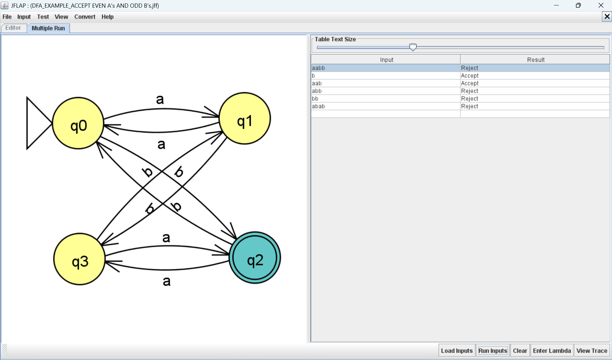
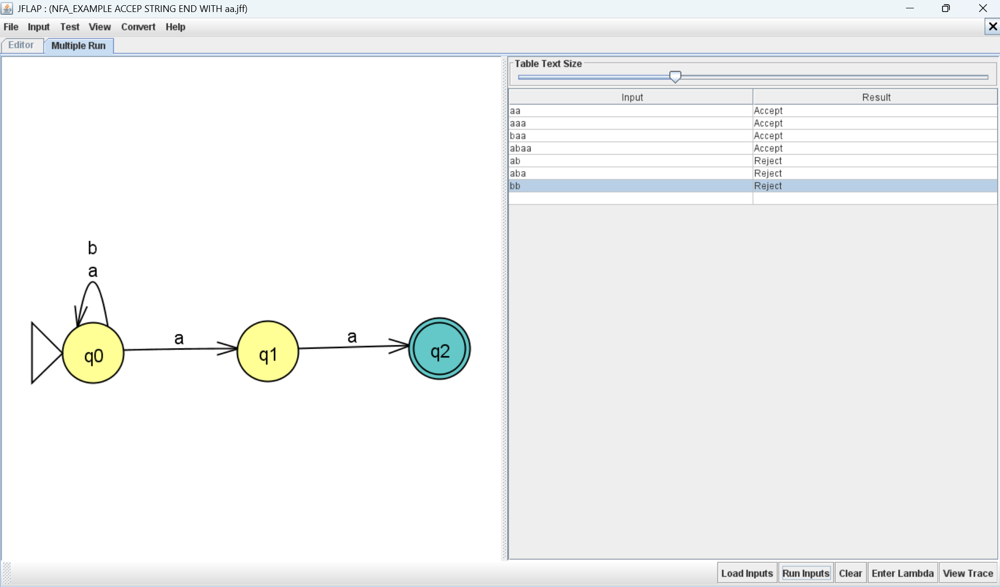
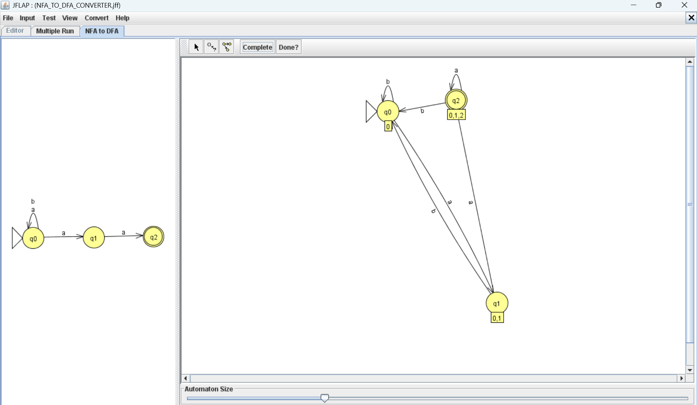
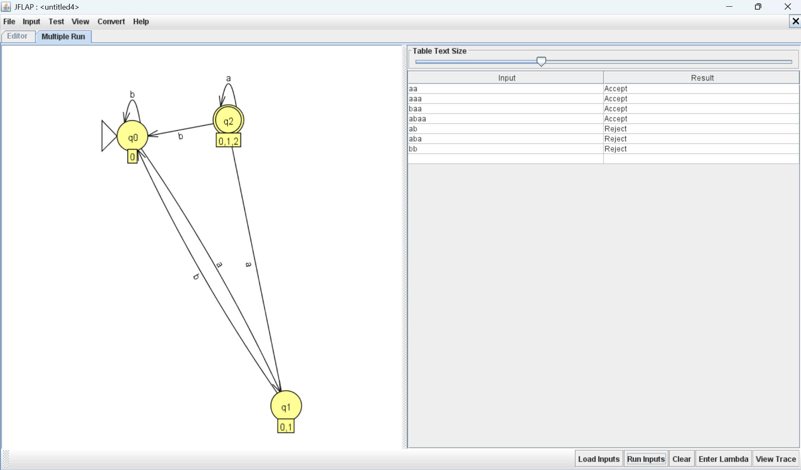
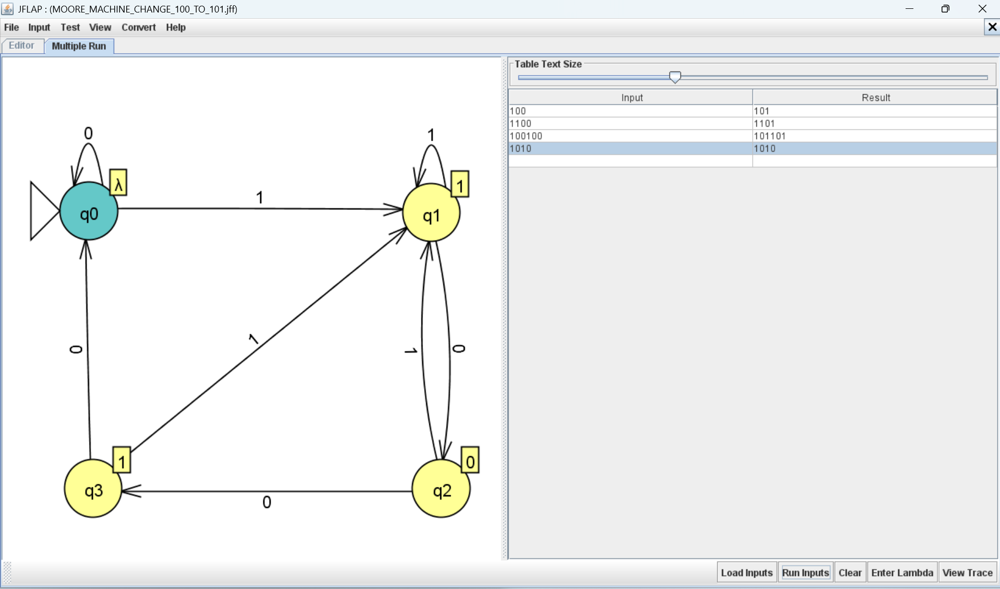
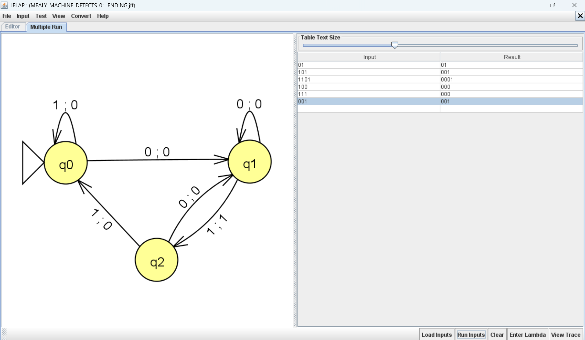

# JFLAP – Theory of Computation Lab

This repository contains my practical work and learning in Theory of Computation using JFLAP. It covers different finite automata and computational models with their implementation and testing.

## Practical Work

### 1. Deterministic Finite Automaton (DFA)

**Experiment:** Checking strings with an even count of `a` and an odd count of `b`.

**JFLAP File:** [`69_DFA_Even_a_Odd_b.jff`](69_DFA_Even_a_Odd_b.jff)

The DFA accepts strings over `{a, b}` only when the number of `a`s is even and the number of `b`s is odd.

**State details:**
- `q0` – Both counts are even (Initial state).
- `q1` – Odd `a`s and even `b`s.
- `q2` – Even `a`s and odd `b`s (Final state).
- `q3` – Both counts are odd.

**Sample testing:**
- Accepted: `b`, `aab`, `abb`
- Rejected: `a`, `ab`, `bb`

**Implementation:**

---

### 2. Nondeterministic Finite Automaton (NFA)

**Experiment:** Recognizing strings ending with `aa`.

**JFLAP File:** [`69_NFA_Ending_With_aa.jff`](69_NFA_Ending_With_aa.jff)

This NFA accepts strings over `{a, b}` whose last two characters are `aa`. It uses nondeterminism to guess where the final pattern begins.

**State details:**
- `q0` – Initial state; reads any number of `a`s and `b`s.
- `q1` – Detects a possible beginning of the final `aa`.
- `q2` – Final state reached after reading the second `a`.

**Sample testing:**
- Accepted: `aa`, `aaa`, `baa`, `abaa`
- Rejected: `ab`, `aba`, `bb`

**Implementation:**

---

### 3. Conversion of NFA into DFA

**Experiment:** NFA to DFA conversion using subset construction.

**JFLAP File:** [`69_NFA_to_DFA_Conversion.jff`](69_NFA_to_DFA_Conversion.jff)

This experiment converts the NFA accepting strings ending with `aa` into an equivalent DFA using the subset construction method.

**Reachable DFA states:**
- `{q0}` – Initial state.
- `{q0, q1}` – Represents possible states after reading `a`.
- `{q0, q1, q2}` – Final state because it contains `q2`.

Every subset containing the original final state `q2` is an accepting state.

**Sample testing:**
- Accepted: `aa`, `aaa`, `baa`
- Rejected: `ab`, `aba`, `bb`

**Implementation:**

---

### 4. Moore Machine

**Experiment:** Changing the pattern `100` to `101`.

**JFLAP File:** [`69_Moore_Machine_100_to_101.jff`](69_Moore_Machine_100_to_101.jff)

This Moore machine is designed to identify the binary pattern `100` and produce the modified pattern `101`.

**State details:**
- `q0` – Initial state.
- `q1` – Tracks the occurrence of `1`.
- `q2` – Tracks the sequence `10`.
- `q3` – Represents detection of the complete sequence `100`.

A Moore machine generates output based on its current state.

**Implementation:**

---

### 5. Mealy Machine

**Experiment:** Detecting strings ending with `01`.

**JFLAP File:** [`69_Mealy_Machine_Ending_With_01.jff`](69_Mealy_Machine_Ending_With_01.jff)

This Mealy machine detects whether a binary string ends with `01`. It produces output `1` when the pattern is detected and `0` for other transitions.

**State details:**
- `q0` – Initial state; no relevant `0` has been detected.
- `q1` – The previous input symbol was `0`.
- `q2` – The pattern `01` has been detected.

**Sample testing:**
- Final output `1`: `01`, `101`, `1101`, `0101`
- Final output `0`: `100`, `111`, `1010`

**Implementation:**

---

## Tools and Technologies

- **Software:** JFLAP
- **Concepts:** DFA, NFA, Subset Construction, Moore Machine, Mealy Machine
- **Subject:** Theory of Computation
